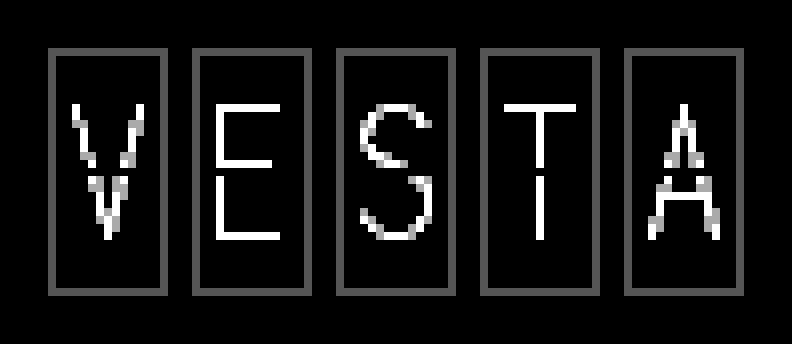

<p align="center"></p>

# Vesta

A split-flap watchface for the Pebble Time, Pebble Time 2 and Pebble Round 2 inspired by the Vestaboard.

On the Pebble Time and Time 2, the face has 4 rows with 8 cells per row. On the Round 2, the rows
follow the round display with 3, 8, 10, 8 and 3 cells; the 3-cell rows are too short for info
and show custom cells. Each row can show any of the following from the settings page, as long
as it fits:

- Time
- Date
- Battery
- Steps
- Day of the week
- Weather
- Custom text

To mimic the Vestaboard, the watchface "flips" through each character in the following order
(blank, A–Z, 1–9, 0, \`! @ # $ ( ) - + & = ; : ' " % , . / ? ° ♥`, then red/orange/yellow/green/blue/violet/white)

Flick your wrist to watch the cells flip!

Weather comes from Open-Meteo through PebbleKit JS.

## Settings page

Settings are changed on a web page hosted at https://vesta.markhenke.com, which opens from the
Pebble phone app. The page's source is not part of this repository. `CONFIG_URL` in
`src/pkjs/index.js` sets which page opens, and the page returns its settings to
`src/pkjs/index.js`, which sends them to the watch as one AppMessage.

## Layout

- `src/c/main.c`: watchface code (flap state machine and framebuffer renderer)
- `font/glyphs.txt`: hand-drawn pixel art for every character (`#` ink, `+` anti-alias, `.` empty)
- `font/glyphs_hd.txt`: the larger set used by the Time 2 and Round 2, in the same format
- `src/c/glyphs.h`: generated from both glyph files; do not edit by hand
- `src/pkjs/index.js`: phone side: opens the settings page, relays settings, fetches weather
- `tools/glyph_compile.py`: regenerates `glyphs.h`; `--preview out.png` renders an enlarged sheet with flip frames (`--preview-hd` for the larger set), and `--logo logo.png` renders the logo
- `tools/demo_gif.py`: renders demo GIFs of the wrist-flick wave and (`--rainbow`) the startup; `--platform emery` or `gabbro` for the Time 2 or Round 2
- `tools/build.sh`: build script (see below)

## Building

```sh
python3 tools/glyph_compile.py        # after editing font/glyphs.txt or font/glyphs_hd.txt
tools/build.sh                        # or `pebble build` if it works on your machine
pebble install --emulator basalt      # or emery (Time 2), gabbro (Round 2)
```

After changing `messageKeys` in `package.json`, delete `build/` first; otherwise the
generated C header can go stale.

pebble-tool runs on the system Python 3.14 and exports that interpreter's `sys.path`
to the SDK's Python 3.13 venv.
